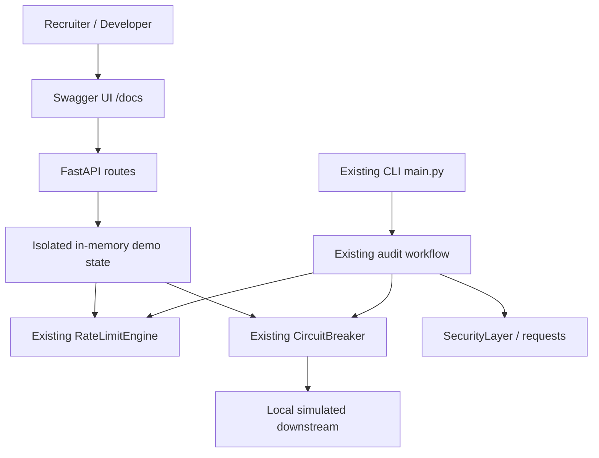

# API Rate-Limit & Circuit-Breaker Resilience Engine

A Python resilience engine with a command-line audit workflow and an interactive FastAPI demonstration. The web application lets reviewers inspect token-bucket rate limiting and circuit-breaker state changes in Swagger UI without connecting to real downstream services.

## Features

- Existing CLI workflow for auditing supplied API endpoints.
- Per-endpoint request limiting, with optional token-bucket refill mode.
- Circuit-breaker failure tracking, with optional timed `OPEN` → `HALF_OPEN` recovery.
- Existing pre-flight URL security validation and HTTP status checks for the audit workflow.
- FastAPI endpoints, generated OpenAPI documentation, Swagger UI, and ReDoc.
- Local simulated downstream service for safe, repeatable browser demonstrations.

## Architecture



The CLI audit path and the browser demonstration are separate. The demo uses local identifiers such as `demo://downstream-service`; it does not call `SecurityLayer.check_endpoint` and does not make outbound HTTP requests.

## Requirements

- Python 3.10 or newer.
- `pip`.
- Internet access only when installing Python packages.

## Installation

Clone the repository and enter its directory:

```bash
git clone https://github.com/Betablank/api-rate-limit-circuit-breaker.git
cd api-rate-limit-circuit-breaker
```

Create a virtual environment:

```bash
python -m venv .venv
```

Activate it on Windows PowerShell:

```powershell
.venv\Scripts\Activate.ps1
```

Activate it on Windows Command Prompt:

```bat
.venv\Scripts\activate
```

Activate it on Linux or macOS:

```bash
source .venv/bin/activate
```

Install the dependencies:

```bash
python -m pip install --upgrade pip
pip install -r requirements.txt
```

## Start the FastAPI application

From the repository root:

```bash
uvicorn web.app:app --reload
```

Open these URLs in your browser:

- Swagger UI: <http://127.0.0.1:8000/docs>
- ReDoc: <http://127.0.0.1:8000/redoc>
- Application information: <http://127.0.0.1:8000/>
- Health: <http://127.0.0.1:8000/health>

In Swagger UI, expand an endpoint, select **Try it out**, and execute the request. The schemas and response codes describe the expected outcomes.

## Rate-limit demonstration

The demo bucket starts with five tokens and refills at 0.5 token per second (one token every two seconds). These are demo settings; the original engine constructor defaults are retained for existing callers.

1. Execute `POST /demo/rate-limit/reset` to refill the bucket.
2. Execute `POST /demo/rate-limit/request` repeatedly with `{}` as the JSON body.
3. The first five requests are accepted while tokens are available.
4. Further requests return HTTP `429 Too Many Requests` and include `X-RateLimit-Limit`, `X-RateLimit-Remaining`, and `Retry-After` headers.
5. Execute `GET /demo/rate-limit/status` to inspect available tokens and refill rate.
6. Wait for refill or reset the bucket to repeat the test.

Example request:

```bash
curl -i -X POST http://127.0.0.1:8000/demo/rate-limit/request \
  -H "Content-Type: application/json" \
  -d '{"label":"browser-demo"}'
```

## Circuit-breaker demonstration

The circuit breaker starts `CLOSED`, opens after two simulated failures, and enters `HALF_OPEN` after its five-second cooldown. One recovery probe is allowed at a time.

1. Execute `POST /demo/circuit-breaker/reset`.
2. Execute `POST /demo/circuit-breaker/request` with `{}` to simulate a successful request.
3. Execute `POST /demo/circuit-breaker/simulate-failure` twice. These controlled failures return HTTP `503`; after the second failure the state becomes `OPEN`.
4. Execute `GET /demo/circuit-breaker/status` to inspect the state and cooldown.
5. While `OPEN`, another request returns HTTP `503` without calling the simulated downstream function.
6. After the cooldown, inspect status again; it transitions to `HALF_OPEN`.
7. Execute a successful `POST /demo/circuit-breaker/request` with `{}`. The recovery probe succeeds and the breaker returns to `CLOSED`.

A failed recovery probe reopens the circuit. Use the reset endpoint to start the scenario again.

## API endpoint reference

| Method | Endpoint | Purpose |
|---|---|---|
| `GET` | `/` | Project information and available demos |
| `GET` | `/health` | Application health |
| `POST` | `/demo/rate-limit/request` | Consume a token; returns 429 when exhausted |
| `GET` | `/demo/rate-limit/status` | Inspect bucket capacity, tokens, and refill rate |
| `POST` | `/demo/rate-limit/reset` | Refill the demo bucket |
| `POST` | `/demo/circuit-breaker/request` | Send a simulated success or requested failure |
| `GET` | `/demo/circuit-breaker/status` | Inspect state, failure count, and recovery timing |
| `POST` | `/demo/circuit-breaker/simulate-failure` | Record a controlled downstream failure |
| `POST` | `/demo/circuit-breaker/reset` | Reset the breaker to CLOSED |

## Run tests

Run the full repository test suite, including the FastAPI tests:

```bash
pytest -v
```

Run only the FastAPI tests:

```bash
pytest -v tests/test_web_app.py
```

The FastAPI tests use `TestClient` and a local simulated downstream. They do not need Redis, a database, or a real external service.

## Existing CLI usage

The original CLI entry point remains `main.py`:

```bash
python main.py --api-endpoints https://httpbin.org/get
```

This command uses the existing endpoint-audit workflow. Only run it against services you own or are authorized to test. It is deliberately separate from the browser demo.

## Important design details

- `RateLimitEngine` retains its original constructor defaults and `check_rate_limit`, `reset_rate_limit`, and `audit` methods. Token refill is enabled only when a caller supplies `refill_rate_per_second`.
- `CircuitBreaker` retains manual-reset behavior by default. Timed recovery is enabled only when `recovery_timeout` is supplied. Existing methods remain available; `record_success` and `get_status` expose recovery behavior to the web app.
- The FastAPI app is created by `create_app()`. A fresh app receives fresh in-memory demo state, which also makes tests isolated.
- The demonstration is process-local. Multiple Uvicorn worker processes have independent counters and breaker state; this is not a distributed rate limiter.

## Security considerations and limitations

- The demonstration endpoints use only local simulation and do not accept arbitrary URLs.
- Reset endpoints are intentionally unauthenticated for local portfolio evaluation. Do not expose this demo publicly without adding authentication, authorization, and request-abuse controls.
- Demo state is in memory and resets when the process restarts.
- The existing CLI audit feature can make outbound HTTP requests through `SecurityLayer`; use it only with authorized targets. The web demo does not invoke that path.
- The existing project has not been converted into a distributed limiter. Shared state across multiple application instances would require a centralized store and atomic operations.
